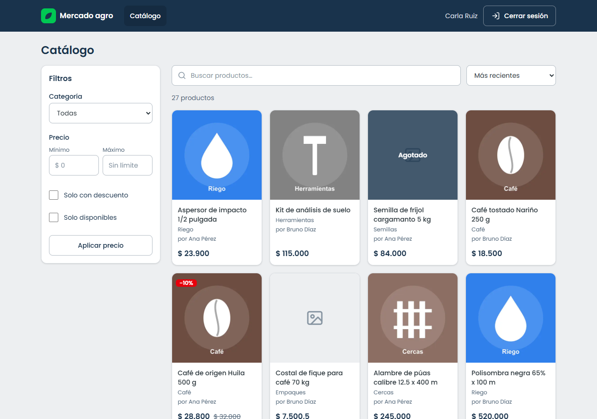
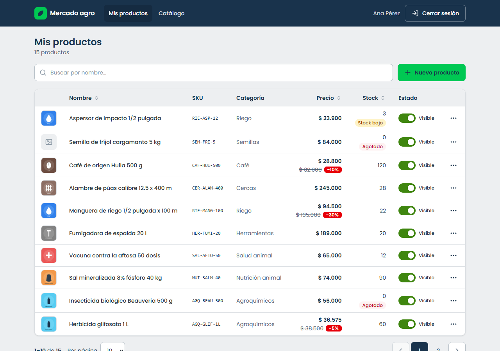
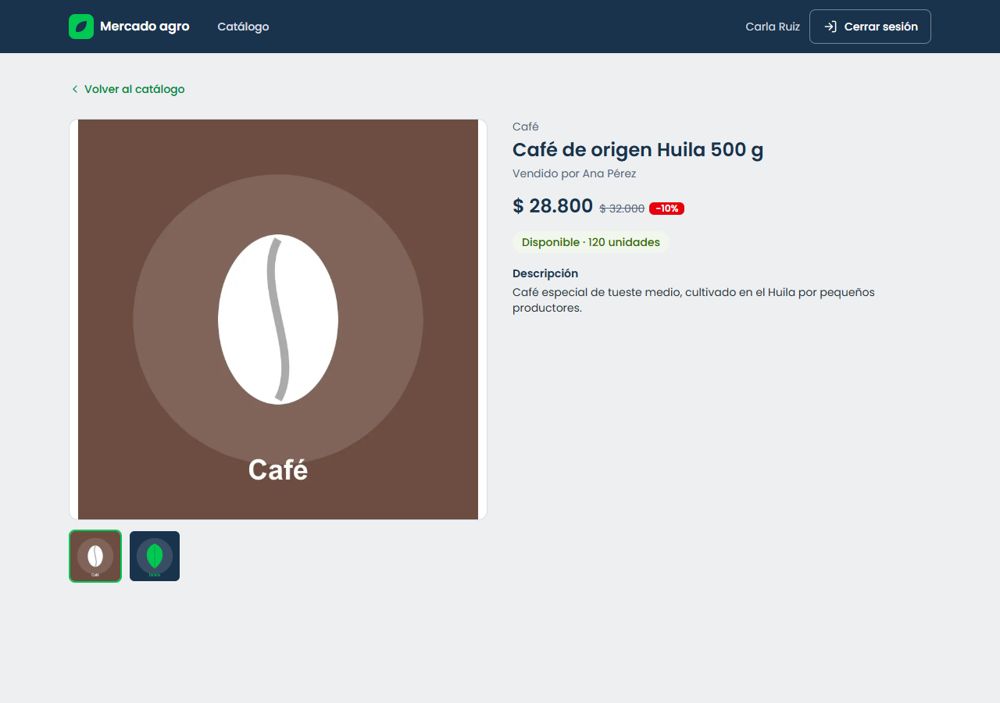
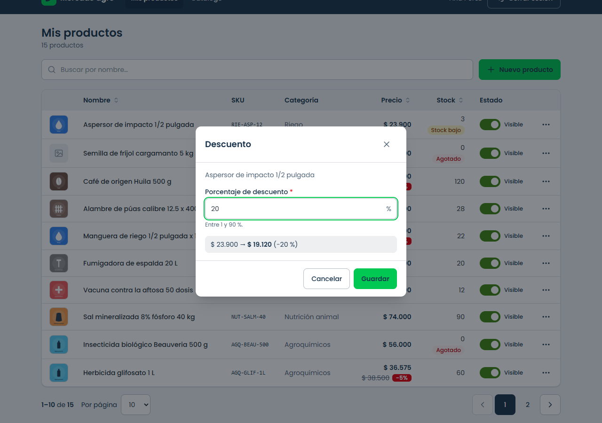

# Prueba Técnica Full Stack – Croper

Solución a la prueba técnica Full Stack de Croper: una API REST con **NestJS + MongoDB**, un frontend con **React + Vite + Redux Toolkit + Tailwind** y las respuestas teóricas de los ejercicios 3 a 5.

Como mejora adicional, la app es un pequeño marketplace agro: los **vendedores** gestionan sus productos (stock, descuentos e imágenes) y los **compradores** recorren un catálogo con filtros. La API sigue el contrato **1.1.0** con prefijo `/api/v1`.

## Contenido de la prueba

| Ejercicio | Qué se entregó | Dónde |
|---|---|---|
| 1 | API REST de productos: CRUD, JWT, validación, errores con formato único, paginación, búsqueda y Swagger | [`backend/`](backend/README.md) · [spec 01](docs/specs/01-backend.md) |
| 2 | Frontend que consume la API: login, registro, gestión de productos, Redux Toolkit, responsive | [`frontend/`](frontend/README.md) · [spec 02](docs/specs/02-frontend.md) |
| 3 | Arquitectura de microservicios para un e-commerce agropecuario | [respuestas-teoricas.md](docs/respuestas-teoricas.md) ([PDF](docs/respuestas-teoricas.pdf)) |
| 4 | Optimización de rendimiento y UX en móviles | [respuestas-teoricas.md](docs/respuestas-teoricas.md) |
| 5 | Seguridad en APIs y cloud | [respuestas-teoricas.md](docs/respuestas-teoricas.md) |

### Funcionalidades adicionales ([spec 03](docs/specs/03-mejoras-roles-vendedor-comprador.md))

- **Roles vendedor y comprador**: se elige al registrarse, viaja en el JWT y cada rol tiene sus rutas en la API y en el frontend.
- **Stock con ajustes atómicos**: el stock se fija al crear y luego solo cambia con entradas/salidas; nunca queda negativo, ni con peticiones simultáneas.
- **Descuentos**: porcentaje de 1 a 90 por producto; el backend calcula y guarda el precio final.
- **Imágenes**: hasta 4 por producto (JPEG, PNG o WebP, máximo 1 MB), re-codificadas a WebP con miniatura.
- **Catálogo para compradores**: tarjetas con imágenes, filtros en la URL (texto, categoría, rango de precio, con descuento, disponibles), orden y detalle con galería.

## Stack

| Parte | Tecnologías |
|---|---|
| Backend | NestJS 12 (ESM), Mongoose 9, Passport JWT, class-validator, Swagger, helmet, throttler, Multer, sharp, file-type |
| Frontend | React 19, TypeScript, Vite 8, Redux Toolkit, React Router, Axios, React Hook Form, Tailwind CSS v4, Headless UI |
| Base de datos | MongoDB (local o la imagen `mongo:7` de [docker-compose.yml](docker-compose.yml)) |
| Tests y calidad | Vitest, supertest (e2e), React Testing Library, oxlint |

## Cómo se desarrolló

El desarrollo fue guiado por specs: antes de generar código se escribió qué debía hacer cada parte, y cada tarea se verificó contra criterios de aceptación concretos. La IA se usó para redactar specs e implementar tareas acotadas, no para generar la app de un solo prompt.

1. **Spec**: una por ejercicio ([01](docs/specs/01-backend.md), [02](docs/specs/02-frontend.md)) y otra para la mejora ([03](docs/specs/03-mejoras-roles-vendedor-comprador.md)).
2. **Contrato**: [api-contract.md](docs/specs/api-contract.md) fija endpoints, tipos y errores entre backend y frontend; es la fuente de verdad.
3. **Tareas**: cada una con su verificación (tests, lint, build) en el [registro de implementación](docs/specs/IMPLEMENTATION_LOG.md), junto con las decisiones D1–D19.
4. **Verificación**: [recorrido real de la API](docs/specs/verificacion-1.1.0.md) con `curl` y respuestas contra una base sembrada.

Detalle del uso de IA: [docs/ia/uso-de-ia.md](docs/ia/uso-de-ia.md).

## Estructura del repositorio

```
prueba_tecnica_croper/
├── backend/                  # Ejercicio 1: API NestJS
│   ├── src/                  # módulos auth, users, products, images; config, common y scripts (seed, export de OpenAPI)
│   ├── test/                 # tests e2e contra MongoDB
│   └── seed/                 # products.json: datos de prueba con imágenes en base64
├── frontend/                 # Ejercicio 2: app React
│   ├── src/                  # api, features (auth, seller, catalog, ui), components, types, utils
│   ├── public/               # archivos estáticos
│   └── docs/screenshots/     # capturas de la app
├── docs/
│   ├── specs/                # specs 01–03, contrato, registro de implementación y verificación
│   ├── ia/                   # uso de IA
│   ├── openapi.json          # OpenAPI exportado de la API
│   └── respuestas-teoricas.md  # Ejercicios 3, 4 y 5 (también en PDF)
├── docker-compose.yml        # MongoDB para desarrollo local
└── CLAUDE.md                 # instrucciones del proyecto para Claude Code
```

## Requisitos

- **Node.js 26.13.1 y npm 11.20.0**: las versiones con las que se desarrolló y probó. Los `package.json` no fijan `engines`.
- **MongoDB** en `localhost:27017`: MongoDB Community Server local (sin autenticación) o Docker con Docker Compose.

## Ejecución en local

### 1. Clonar el repositorio

```bash
git clone https://github.com/Snayder2/prueba_tecnica_croper.git
cd prueba_tecnica_croper
```

### 2. Levantar MongoDB

- **Opción A – instalación local:** instala MongoDB Community Server y déjalo corriendo en `mongodb://localhost:27017`.
- **Opción B – Docker** (desde la raíz del repo):

  ```bash
  docker compose up -d
  ```

  Crea el contenedor `croper-mongo` con un volumen para los datos. Es solo para desarrollo: no tiene usuario ni contraseña.

### 3. Backend

```bash
cd backend
npm install
cp .env.example .env            # PowerShell: Copy-Item .env.example .env
```

| Variable | Valor en `.env.example` | Para qué sirve |
|---|---|---|
| `PORT` | `3000` | Puerto HTTP de la API |
| `MONGO_URI` | `mongodb://localhost:27017/productos_db` | Conexión a MongoDB |
| `JWT_SECRET` | marcador de texto | Clave para firmar los tokens. Cámbiala por un valor largo y aleatorio |
| `JWT_EXPIRES_IN` | `1h` | Vigencia del token (`3600`, `30m`, `1h`, `1d`) |
| `CORS_ORIGIN` | `http://localhost:5173` | Único origen permitido: el frontend |
| `PUBLIC_BASE_URL` | `http://localhost:3000` | Base de las URLs absolutas de las imágenes |

Todas son obligatorias: si falta alguna o tiene un formato inválido, la API no arranca y dice cuál es. Para generar `JWT_SECRET`:

```bash
node -e "console.log(require('crypto').randomBytes(48).toString('hex'))"
```

Iniciar en modo desarrollo:

```bash
npm run start:dev
```

### 4. Datos de prueba

Con MongoDB corriendo, desde `backend/` (en otra terminal si la API ya está iniciada):

```bash
npm run seed
```

**Borra todos los documentos de `users` y `products`** de la base de `MONGO_URI` y crea 2 vendedores, 1 comprador y 30 productos con imágenes (8 con descuento, 3 agotados y 3 ocultos). Se puede repetir para volver a ese estado.

### 5. Frontend

```bash
cd frontend
npm install
cp .env.example .env            # PowerShell: Copy-Item .env.example .env
npm run dev
```

`frontend/.env` solo tiene `VITE_API_URL=http://localhost:3000/api/v1`. El puerto **5173 es fijo** (`strictPort` en `vite.config.ts`) porque es el único origen que permite el CORS del backend: si está ocupado, `npm run dev` falla en lugar de arrancar en otro puerto donde las peticiones serían rechazadas.

### 6. URLs

| Qué | URL |
|---|---|
| Frontend | http://localhost:5173 |
| API | http://localhost:3000/api/v1 |
| Swagger UI | http://localhost:3000/api/docs |
| OpenAPI JSON | http://localhost:3000/api/docs-json |

### 7. Usuarios de prueba

Creados por `npm run seed`, todos con la contraseña `Clave1234`:

| Email | Rol | Entra a |
|---|---|---|
| `ana.vendedora@correo.com` | Vendedor | `/seller/products` |
| `bruno.vendedor@correo.com` | Vendedor | `/seller/products` |
| `carla.compradora@correo.com` | Comprador | `/catalog` |

- **Vendedor:** ve y gestiona solo sus productos: crear, editar, eliminar, ajustar stock, aplicar o quitar descuentos, subir y borrar imágenes, y mostrar u ocultar en el catálogo. No ve el catálogo en el frontend.
- **Comprador:** recorre el catálogo de todos los vendedores (solo productos visibles) y su detalle. Recibe 403 en cualquier endpoint `/seller/...`.

También se puede crear una cuenta desde `/register` eligiendo "Quiero comprar" o "Quiero vender".

### 8. Si el puerto 3000 está ocupado

Usa otro puerto en los dos `.env` (por ejemplo 3001):

| Archivo | Variable | Valor |
|---|---|---|
| `backend/.env` | `PORT` | `3001` |
| `backend/.env` | `PUBLIC_BASE_URL` | `http://localhost:3001` |
| `frontend/.env` | `VITE_API_URL` | `http://localhost:3001/api/v1` |

Reinicia el backend y `npm run dev`. Vuelve a ejecutar `npm run seed`: las URLs de las imágenes se guardan con `PUBLIC_BASE_URL` al sembrar.

## Recorrido sugerido

1. Entra en http://localhost:5173 como `ana.vendedora@correo.com` / `Clave1234`: llegas a "Mis productos".
2. Crea un producto. Al guardarlo se abre el diálogo de imágenes: sube una JPG, PNG o WebP de hasta 1 MB.
3. En el menú "⋯" del producto, aplica un **Descuento** (por ejemplo 15 %) y mira la vista previa del precio final.
4. Usa **Ajustar stock**: una salida mayor al stock disponible no se envía.
5. Cierra sesión y entra como `carla.compradora@correo.com`: en el catálogo filtra por categoría o "Solo con descuento" y abre el detalle con galería.
6. Escribe `/seller/products` en la barra de direcciones: vuelves al catálogo con el aviso "No tienes acceso a esa sección.".
7. En Swagger (http://localhost:3000/api/docs), haz `POST /auth/login`, copia el `accessToken`, pulsa **Authorize**, pégalo sin `Bearer` y prueba los endpoints de `Catalog` y `Seller products`.

## Capturas

| Catálogo (comprador) | Mis productos (vendedor) |
|---|---|
|  |  |
|  |  |

Más capturas (móvil, filtros, stock, imágenes, registro) en el [README del frontend](frontend/README.md#capturas).

## Tests y calidad

| Dónde | Comando | Qué hace |
|---|---|---|
| `backend/` | `npm test` | Tests unitarios (Vitest) |
| `backend/` | `npm run test:e2e` | Criterios de aceptación contra MongoDB real: concurrencia del stock, límite de imágenes, subida real y endpoint público de imágenes. Usa la base **`productos_db_e2e`** en `localhost:27017` y la **borra** |
| `backend/` | `npm run lint` | oxlint con análisis de tipos |
| `backend/` | `npm run build` | Compila a `dist/` |
| `backend/` | `npm run docs:export` | Regenera `docs/openapi.json` (no necesita MongoDB) |
| `frontend/` | `npm test` | Tests de slices, utilidades, componentes y rutas (Vitest + Testing Library) |
| `frontend/` | `npm run lint` | oxlint; también impide importar `axios` fuera de `src/api/` |
| `frontend/` | `npm run build` | Comprueba tipos (`tsc -b`) y genera `dist/` |

## Documentación de la API

- **Swagger UI** en http://localhost:3000/api/docs con la API corriendo: cada endpoint documenta parámetros, cuerpos y respuestas con ejemplos. Tags: `Auth`, `Catalog` y `Seller products`.
- **[docs/openapi.json](docs/openapi.json)**: la misma especificación exportada (versión 1.1.0), para verla sin levantar el backend.
- Tabla de endpoints, ejemplos `curl` y seguridad: [backend/README.md](backend/README.md).

## Decisiones técnicas destacadas

- **Precio final en centavos enteros, mitades hacia arriba**, con la misma fórmula en JS y en la agregación de MongoDB, sin `$round` ([D1](docs/specs/IMPLEMENTATION_LOG.md#decisiones)).
- **Stock atómico**: la salida es un único `findOneAndUpdate` con `stock: { $gte: cantidad }`; diez salidas simultáneas sobre stock 5 dan cinco 200 y cinco 409 ([tarea 6](docs/specs/IMPLEMENTATION_LOG.md#tarea-6-ajuste-de-stock-atómico)).
- **Propiedad por vendedor**: toda consulta del vendedor filtra por `{ _id, sellerId }` y `sellerId` sale del token; un producto ajeno responde 404 ([tarea 4](docs/specs/IMPLEMENTATION_LOG.md#tarea-4-catalogcontroller-y-sellerproductscontroller)).
- **Imágenes en base64 dentro de MongoDB**, máximo 4 por producto, servidas por un endpoint público; sin archivos en disco ni huérfanos que limpiar ([D19](docs/specs/IMPLEMENTATION_LOG.md#decisiones)).
- **Límite de subidas por usuario** con `UserThrottlerGuard`, porque el guard global corre antes de la autenticación ([D7](docs/specs/IMPLEMENTATION_LOG.md#decisiones)).
- **Búsqueda sin mayúsculas ni tildes** y con el texto escapado, para que no se pueda inyectar una expresión regular ([D8](docs/specs/IMPLEMENTATION_LOG.md#decisiones)).
- **Atomicidad y concurrencia probadas en e2e** contra MongoDB real, porque los unitarios usan mocks del modelo ([D17](docs/specs/IMPLEMENTATION_LOG.md#decisiones)).

## Fuera de alcance

Refresh tokens, almacenamiento en la nube o despliegue, carrito y órdenes, rol `admin` y un usuario con los dos roles.

## Problemas comunes

- **MongoDB no está corriendo**: la API, `npm run seed` y `npm run test:e2e` necesitan MongoDB en `localhost:27017`. Inicia el servicio local o ejecuta `docker compose up -d` desde la raíz.
- **El frontend no puede llamar a la API (CORS)**: el backend solo acepta `CORS_ORIGIN=http://localhost:5173`. No sirvas el frontend en otro puerto, y si cambias el puerto del backend, actualiza también `VITE_API_URL` (ver [paso 8](#8-si-el-puerto-3000-está-ocupado)).
- **No ejecutes `npm audit fix --force`**: baja Vitest y Vite de versión (el proyecto necesita Vitest ≥ 4 y Vite ≥ 8) y rompe la inyección de dependencias y la validación en los tests.
