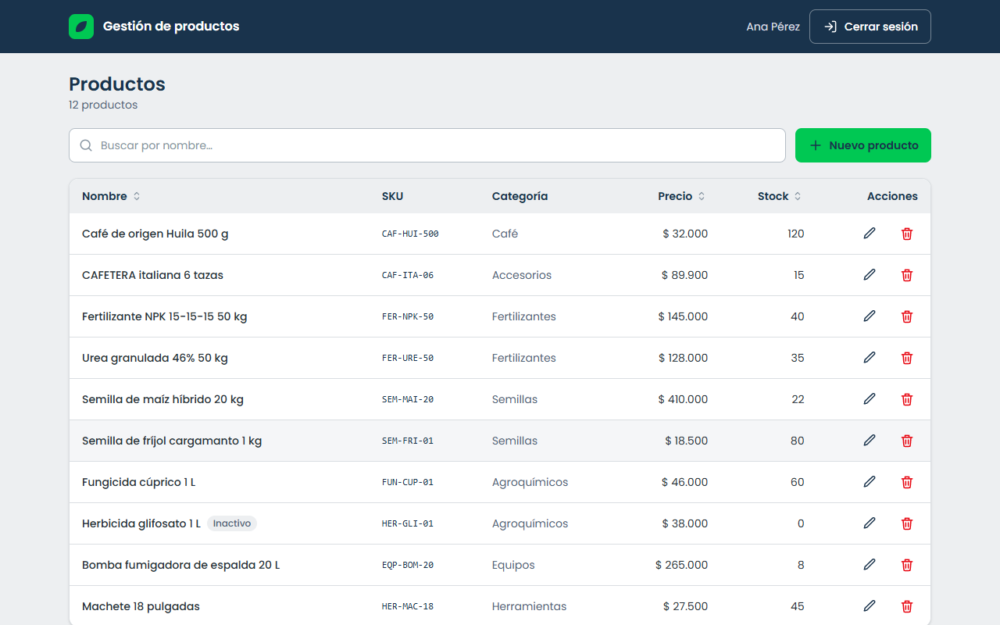
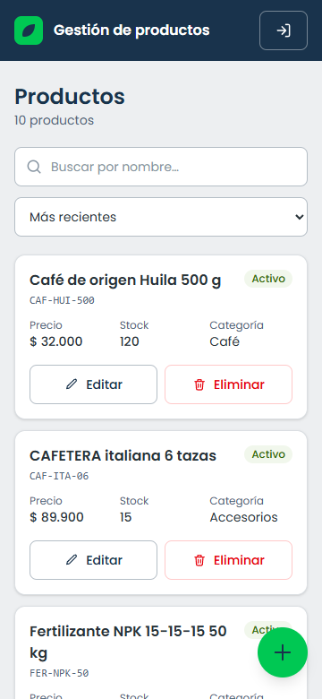
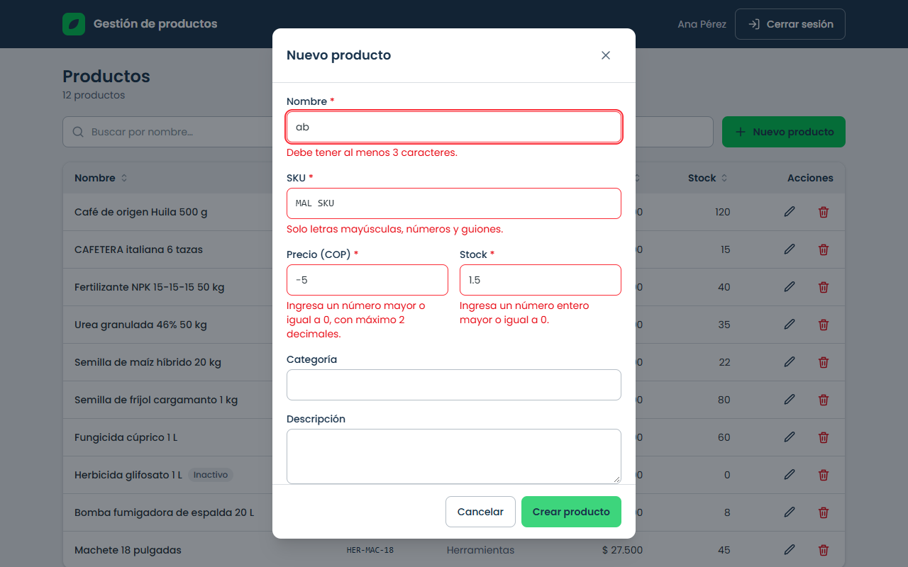
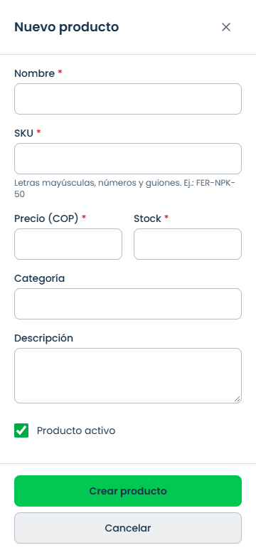
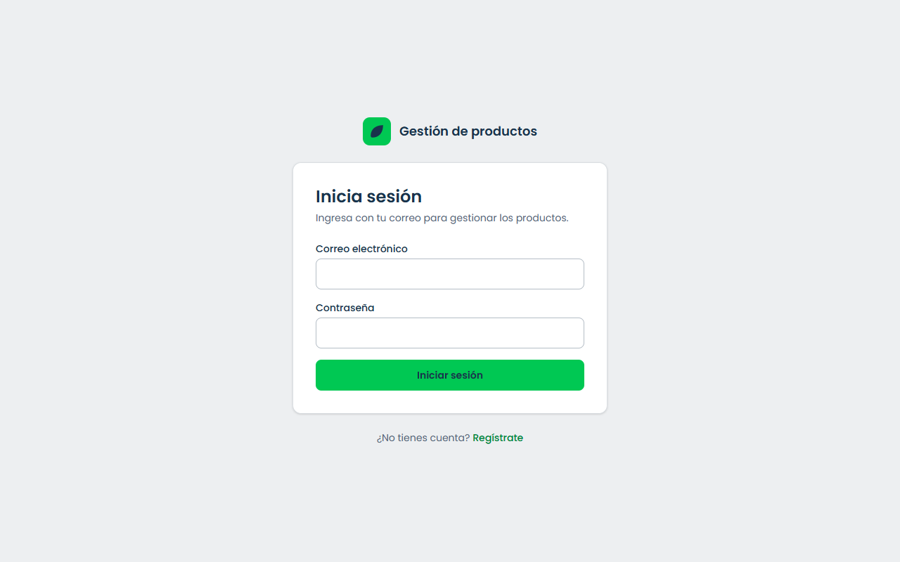

# Frontend – Gestión de Productos (Ejercicio 2)

Interfaz web que consume la API del ejercicio 1 para listar, crear, editar y eliminar productos, con sesión JWT, paginación y búsqueda desde el servidor, y diseño responsive.

- Especificación: [docs/specs/02-frontend.md](../docs/specs/02-frontend.md)
- Contrato con el backend: [docs/specs/api-contract.md](../docs/specs/api-contract.md)

## Capturas

| Escritorio (1280 px) | Móvil (360 px) |
|---|---|
|  |  |
|  |  |



## Stack

React 19 + TypeScript (estricto) + Vite · Redux Toolkit (`createSlice` + `createAsyncThunk`) · React Router · Axios · React Hook Form · Tailwind CSS v4 · Headless UI · Vitest + React Testing Library · oxlint.

## Requisitos

- Node.js LTS y npm
- El backend corriendo (ver [backend/README.md](../backend/README.md)) con `CORS_ORIGIN=http://localhost:5173`

## Instalación y ejecución

```bash
cd frontend
npm install
cp .env.example .env        # PowerShell: Copy-Item .env.example .env
npm run dev                 # http://localhost:5173
```

El puerto 5173 es fijo (`strictPort`): es el único origen que permite el CORS del backend. Si está ocupado, `npm run dev` falla en lugar de usar otro puerto en el que las peticiones serían rechazadas.

## Variables de entorno

| Variable | Valor por defecto | Descripción |
|---|---|---|
| `VITE_API_URL` | `http://localhost:3000/api/v1` | URL base de la API. Si tu backend usa otro puerto (por ejemplo `PORT=3001`), cámbialo en tu `.env` local |

## Scripts

| Comando | Qué hace |
|---|---|
| `npm run dev` | Servidor de desarrollo |
| `npm run build` | Comprueba tipos (`tsc -b`) y genera `dist/` |
| `npm run lint` | oxlint. Incluye una regla que **impide importar `axios` fuera de `src/api/`** |
| `npm test` | Tests de `productsSlice` (reducers y estados de los thunks) |
| `npm run preview` | Sirve el build de producción |

## Cómo está organizado

Estructura por funcionalidad (spec §10):

```
src/
├── App.tsx                 # rutas: /login, /register, /products (protegida), *
├── app/                    # store y hooks tipados (useAppDispatch, useAppSelector, createAppAsyncThunk)
├── api/                    # único lugar con axios: cliente con interceptores, authApi, productsApi
├── features/
│   ├── auth/               # authSlice, LoginPage, RegisterPage
│   ├── products/           # productsSlice, ProductsPage, componentes (tabla, tarjetas, diálogos…), tests
│   └── ui/                 # uiSlice y notificaciones
├── components/             # genéricos: ProtectedRoute, AppLayout, ErrorBoundary, EmptyState, Button…
├── hooks/useDebounce.ts
├── types/                  # tipos del contrato (Product, User, PaginatedResponse, ApiError)
└── utils/                  # errorMessages (mensajes amigables) y formatters (COP, fechas)
```

### Estado (Redux Toolkit)

| Slice | Guarda | Acciones |
|---|---|---|
| `auth` | `token`, `user`, `status`, `error` | Thunks `login`, `register`, `fetchMe`; reducer `logout` |
| `products` | `items`, `meta`, `filters`, `status`, `error`, `saving` | Thunks `fetchProducts`, `createProduct`, `updateProduct`, `deleteProduct`; reducers `setPage`, `setLimit`, `setSearch`, `setSort` |
| `ui` | `notifications` | `showNotification`, `hideNotification` |

Flujo: componente → `dispatch(thunk)` → `api/` (axios) → backend → reducer (`pending` / `fulfilled` / `rejected`) → `useAppSelector`. Los formularios usan estado local (React Hook Form) y los diálogos `useState`. Todo se puede seguir en Redux DevTools.

- El token se guarda en `localStorage`; al recargar se recupera el usuario con `GET /auth/me`.
- Después de crear, editar o eliminar se vuelve a pedir la página actual. Si se elimina el último producto de una página, se retrocede a la anterior.
- Un cambio de página o de búsqueda cancela la petición anterior, así que nunca llega una respuesta vieja.

### Errores

- `api/client.ts` añade `Authorization: Bearer <token>` y convierte cada error del backend en un mensaje en español (`utils/errorMessages.ts`).
- Los errores de validación (400) y el SKU o email duplicado (409) se muestran junto a su campo.
- Un 401 con sesión activa cierra la sesión, lleva a `/login` y muestra "Tu sesión expiró, inicia sesión de nuevo".
- Sin conexión: "No pudimos conectar con el servidor…" con botón **Reintentar**.
- Un `ErrorBoundary` en la raíz evita la pantalla en blanco si falla el renderizado.

### Responsive y accesibilidad

- Móvil (< 768 px): tarjetas, selector de orden, botón flotante "Nuevo" y diálogos a pantalla completa.
- Tablet (≥ 768 px): tabla sin la columna Categoría. Escritorio (≥ 1024 px): tabla completa.
- Zonas táctiles de 44 px, `label` en todos los campos, `aria-label` en los botones de icono, foco visible y diálogos accesibles (foco atrapado y Escape) con Headless UI.
- Paleta de la sección 14 de la spec. El verde `brand-500` siempre lleva texto azul marino, nunca blanco, por contraste.

## Verificación

Además de `npm test`, la app se probó en un navegador real (Edge, con Playwright) contra el backend, en 1280, 768 y 360 px. Se comprobaron todos los criterios de la spec §11: redirecciones de sesión, login correcto e incorrecto, sesión al recargar, token expirado, cerrar sesión, paginación, búsqueda, orden, crear, editar (solo cambios), eliminar (incluida la página vacía), SKU duplicado, backend caído con **Reintentar**, vistas responsive y consola sin errores. Las capturas de arriba salen de esa prueba.

## Decisiones

- **Token en `localStorage`**: simple y suficiente para la prueba. En producción iría en una cookie `httpOnly` (ver ejercicio 5).
- **`createAsyncThunk` en lugar de RTK Query**: deja explícitos los estados `pending`/`fulfilled`/`rejected`.
- **Tailwind + Headless UI** en lugar de una librería de componentes: identidad visual propia y accesibilidad en los diálogos.
- **Registro**: después de crear la cuenta se inicia sesión automáticamente.
- **Precios** en pesos colombianos (COP).
