# Frontend – Mercado agro (Ejercicio 2 + spec 03)

Interfaz web que consume la API del ejercicio 1 (contrato **1.1.0**) para dos tipos de usuario:

- **Vendedor:** gestiona sus productos en una tabla (crear, editar, eliminar, ajustar stock, descuentos, imágenes y visibilidad).
- **Comprador:** recorre el catálogo de todos los vendedores en tarjetas, con filtros y página de detalle.

Especificaciones:

- Ejercicio 2 (versión 1.0): [docs/specs/02-frontend.md](../docs/specs/02-frontend.md).
- Vendedores y compradores: [docs/specs/03-mejoras-roles-vendedor-comprador.md](../docs/specs/03-mejoras-roles-vendedor-comprador.md).
- Contrato con el backend: [docs/specs/api-contract.md](../docs/specs/api-contract.md).

## Capturas

| Escritorio (1280 px) | Móvil (360 px) |
|---|---|
| 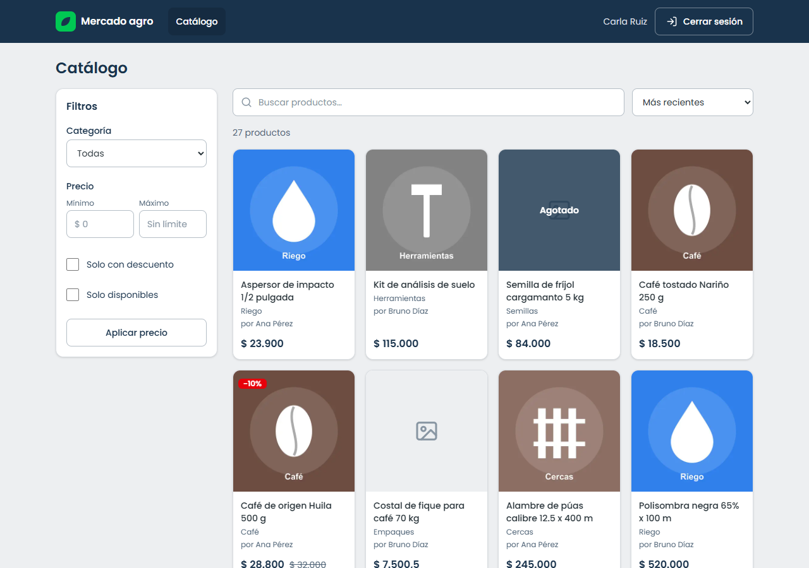 | 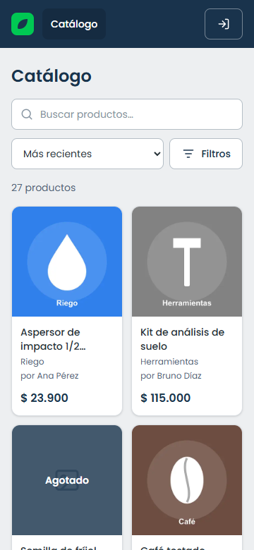 |
| 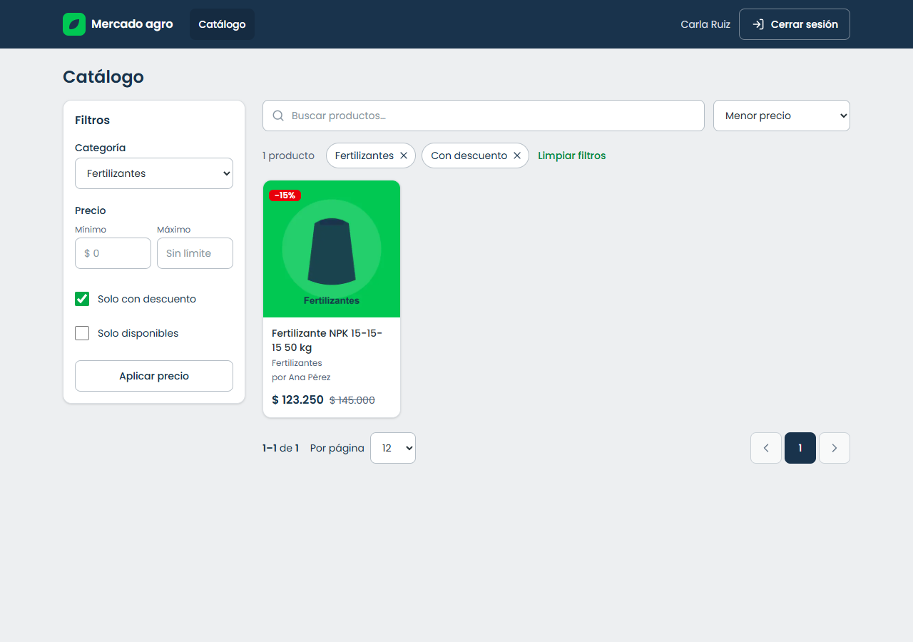 | 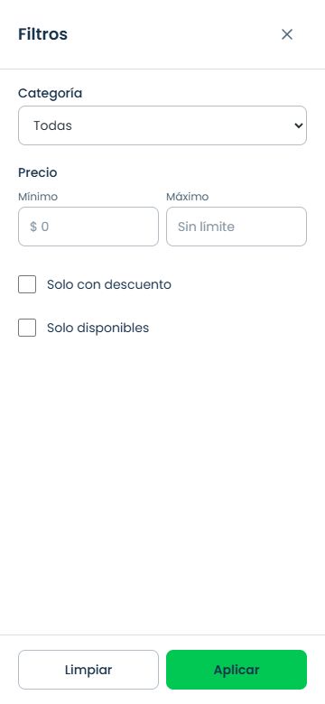 |
| 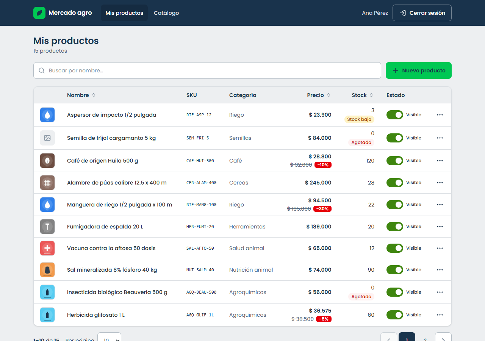 | 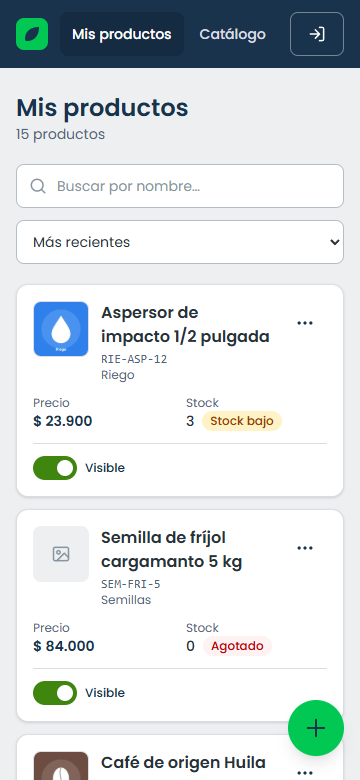 |

| | |
|---|---|
|  | 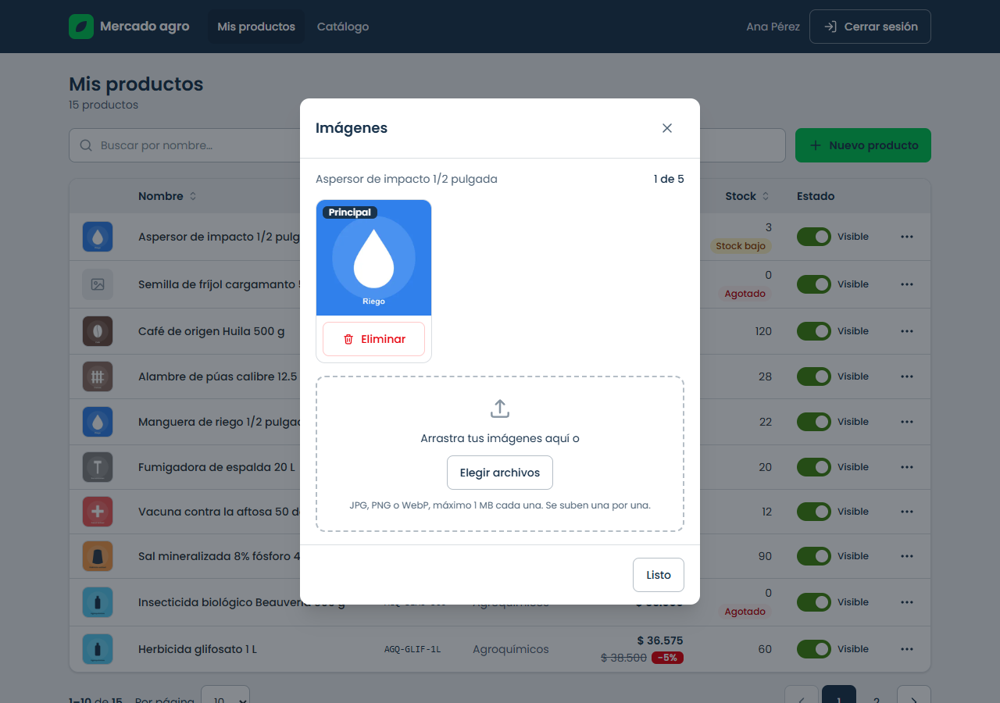 |
| 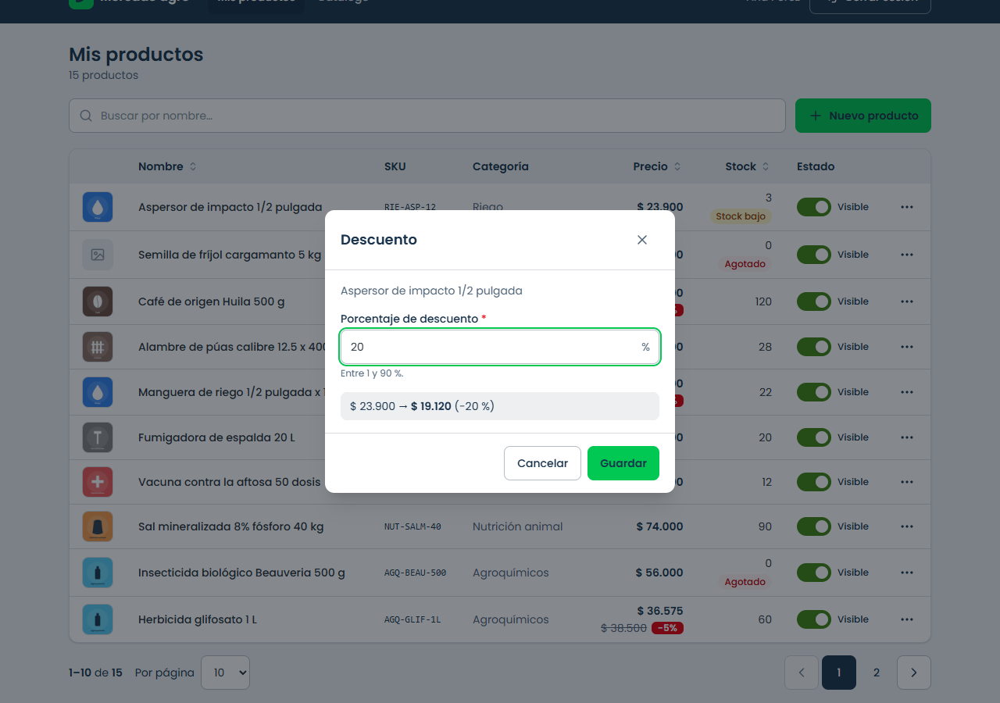 | 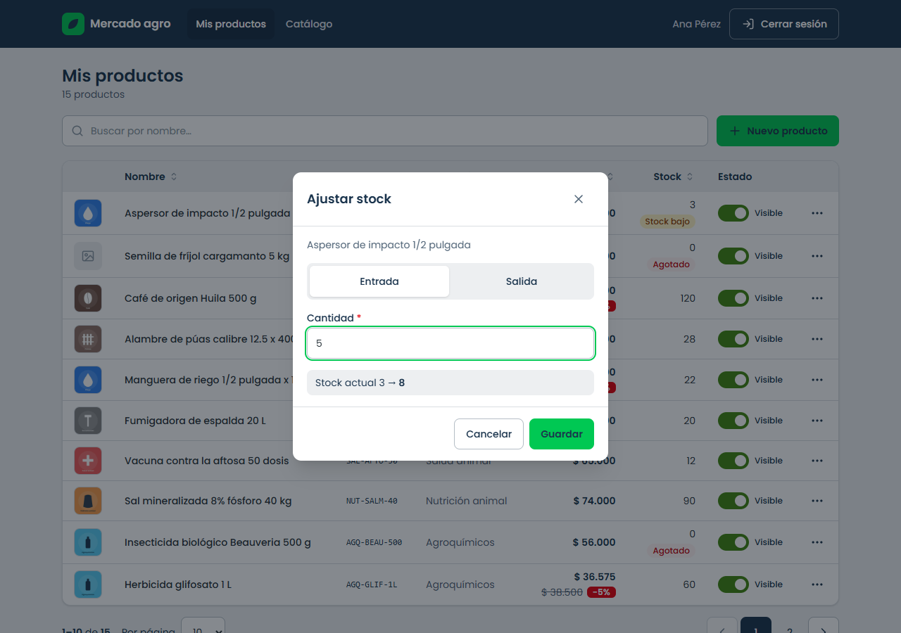 |
| 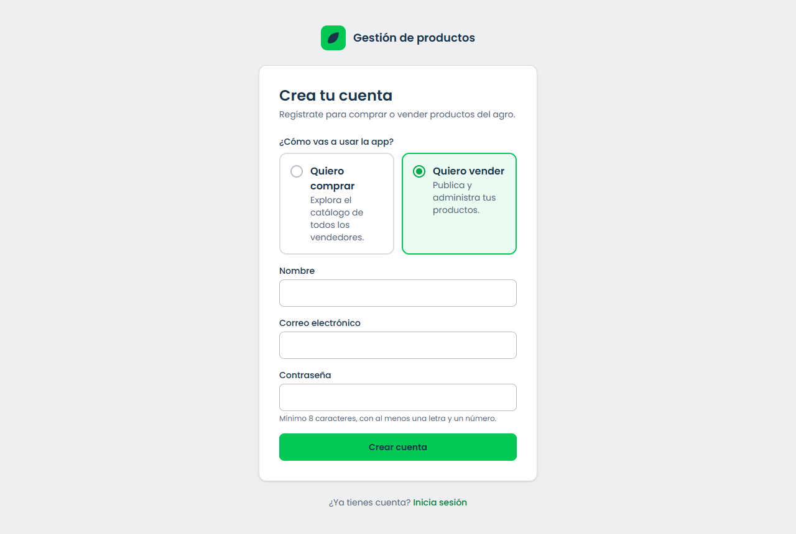 | 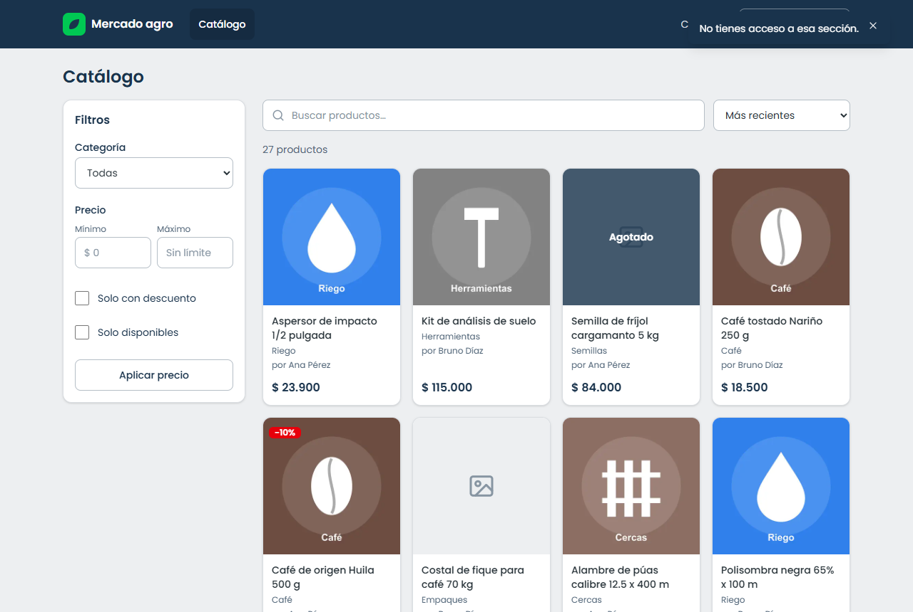 |

## Stack

React 19 + TypeScript (estricto) + Vite · Redux Toolkit (`createSlice` + `createAsyncThunk`) · React Router · Axios · React Hook Form · Tailwind CSS v4 · Headless UI · Vitest + React Testing Library · oxlint.

## Requisitos

- Node.js LTS y npm.
- El backend corriendo (ver [backend/README.md](../backend/README.md)) con `CORS_ORIGIN=http://localhost:5173`, y con datos de prueba si quieres entrar sin registrarte (`npm run seed` en `backend/`).

## Instalación y ejecución

```bash
cd frontend
npm install
cp .env.example .env        # PowerShell: Copy-Item .env.example .env
npm run dev                 # http://localhost:5173
```

El puerto 5173 es fijo (`strictPort`): es el único origen que permite el CORS del backend. Si está ocupado, `npm run dev` falla en lugar de usar otro puerto en el que las peticiones serían rechazadas.

## Usuarios de prueba

Con la base reiniciada (`npm run seed` en `backend/`), todos con la contraseña `Clave1234`:

| Rol | Email | Entra a |
|---|---|---|
| Vendedor | `ana.vendedora@correo.com` | `/seller/products` |
| Vendedor | `bruno.vendedor@correo.com` | `/seller/products` |
| Comprador | `carla.compradora@correo.com` | `/catalog` |

También puedes registrarte eligiendo "Quiero comprar" o "Quiero vender". Para volver a los datos iniciales, ejecuta otra vez `npm run seed` (ver [backend/README.md](../backend/README.md#base-de-datos-y-datos-de-prueba)).

## Variables de entorno

| Variable | Valor por defecto | Descripción |
|---|---|---|
| `VITE_API_URL` | `http://localhost:3000/api/v1` | URL base de la API. Si tu backend usa otro puerto (por ejemplo `PORT=3001`), cámbialo en tu `.env` local |

## Scripts

| Comando | Qué hace |
|---|---|
| `npm run dev` | Servidor de desarrollo |
| `npm run build` | Comprueba tipos (`tsc -b`) y genera `dist/` |
| `npm run lint` | oxlint. Incluye una regla que **impide importar `axios` fuera de `src/api/`** |
| `npm test` | Tests de slices, utilidades, componentes y rutas (101 tests) |
| `npm run preview` | Sirve el build de producción |

## Roles y rutas

| Ruta | Pantalla | Acceso |
|---|---|---|
| `/login`, `/register` | Inicio de sesión y registro con selector de rol | Pública |
| `/` | Redirige según el rol: vendedor → `/seller/products`, comprador → `/catalog` | Con sesión |
| `/catalog` | Catálogo en tarjetas con filtros | Comprador y vendedor |
| `/catalog/:id` | Detalle con galería | Comprador y vendedor |
| `/seller/products` | Mis productos | Solo vendedor |

- El rol sale de `GET /auth/me`; el token nunca se decodifica en el navegador.
- Un comprador que escribe `/seller/products` termina en `/catalog` con el aviso "No tienes acceso a esa sección.".
- La barra superior muestra "Mis productos" y "Catálogo" al vendedor, y solo "Catálogo" al comprador.

## Cómo está organizado

Estructura por funcionalidad (spec 02 §10 y spec 03 §16):

```
src/
├── App.tsx, app/           # store, hooks tipados, rutas (routes.tsx) y páginas diferidas
├── api/                    # único lugar con axios: client, authApi, productsApi (/seller/products), catalogApi
├── features/
│   ├── auth/               # authSlice (rol, selectRole, selectHomePath), login, registro con RoleSelector
│   ├── seller/             # sellerProductsSlice, SellerProductsPage, tabla, tarjetas, menú y diálogos
│   ├── catalog/            # catalogSlice, CatalogPage, ProductDetailPage, filtros, chips, galería
│   └── ui/                 # uiSlice y notificaciones
├── components/             # genéricos: ProtectedRoute, AppLayout, Pagination, PriceTag, Button…
├── types/                  # tipos del contrato 1.1.0
└── utils/                  # errorMessages, formatters, pricing, imageValidation, catalogQuery
```

### Estado (Redux Toolkit)

| Slice | Guarda | Thunks |
|---|---|---|
| `auth` | `token`, `user` (con `role`), `status`, `error` | `login`, `register`, `fetchMe` |
| `sellerProducts` | `items`, `meta`, `filters`, `status`, `error`, `saving`, `togglingIds` | `fetchProducts`, `createProduct`, `updateProduct`, `deleteProduct`, `adjustStock`, `setDiscount`, `removeDiscount`, `toggleActive`, `uploadImage`, `deleteImage`, `reorderImages` |
| `catalog` | `items`, `meta`, `categories`, `selected` y su estado, `status`, `error` | `fetchCatalog`, `fetchCategories`, `fetchCatalogProduct` |
| `ui` | `notifications` | — |

- **Acciones de fila:** stock, descuento, visibilidad, edición e imágenes reemplazan el producto en `items` con la respuesta del backend, sin volver a pedir la lista. Crear y eliminar recargan la página actual.
- **Filtros del catálogo en la URL** (`/catalog?category=Café&onSale=true&page=2`): la URL es la fuente de verdad (`parseCatalogQuery` → `fetchCatalog`). Se pueden compartir, sobreviven a la recarga y el botón "atrás" funciona.
- **Progreso de subida:** es estado local del diálogo. El thunk `uploadImage` recibe `onProgress`, que no es serializable igual que el `File`, por eso el store ignora `meta.arg.onProgress` y `meta.arg.file` en su `serializableCheck`.

### Vendedor (`/seller/products`)

- Columnas: miniatura, nombre, SKU, categoría, precio (final, con el de lista tachado y la etiqueta `-15%`), stock con "Stock bajo"/"Agotado", interruptor "Visible / Oculto" y menú "⋯" (Editar, Imágenes, Ajustar stock, Descuento, Eliminar).
- **Ajustar stock:**
  - Entrada/Salida, cantidad y vista previa "Stock actual 40 → 45".
  - Una salida mayor al stock no se envía.
  - Si el backend responde 409, el error se muestra en el diálogo y el stock se actualiza.
- **Descuento:** porcentaje de 1 a 90 con vista previa en vivo ("$ 145.000 → $ 123.250 (-15 %)"), calculada con la misma fórmula del backend.
- **Imágenes:**
  - Hasta 5 por producto; la primera es la principal.
  - Se puede hacer principal una imagen, o eliminarla con confirmación.
  - Para agregar, se arrastran o se eligen varios archivos. Se validan antes de subir (JPG/PNG/WebP, máximo 1 MB): los rechazados no se envían, y los demás se suben uno por uno con su barra de progreso.
  - Después de crear un producto el diálogo se abre solo.
- Al editar, el stock es solo lectura, con un enlace "Ajustar stock".

### Comprador (`/catalog`)

- Grilla de 2 columnas (móvil), 3 (tablet) y 4 (≥ 1280 px). Paginación numerada de 12, 24 o 48.
- **Filtros:** categoría, rango de precio sobre el precio final, solo con descuento y solo disponibles.
  - En escritorio, panel fijo a la izquierda. Debajo de 1024 px, el botón "Filtros (n)" abre un panel lateral con "Aplicar" y "Limpiar".
  - Encima de la grilla van el buscador (400 ms de espera), el orden, el total y los chips de los filtros activos.
- **Tarjetas:** imagen cuadrada con `loading="lazy"`, etiqueta de descuento, capa "Agotado", nombre en 2 líneas, categoría, vendedor y precio.
- **Detalle:** galería con miniaturas elegibles con clic o con las flechas, precio, disponibilidad ("Disponible · 12 unidades" o "Agotado") y descripción. "← Volver al catálogo" conserva los filtros.
- **Estados:** esqueletos, recarga sin parpadeo, "No encontramos productos con esos filtros", "Todavía no hay productos publicados" y error con "Reintentar".

### Errores

- `api/client.ts` añade `Authorization: Bearer <token>` y convierte cada error en un mensaje en español (`utils/errorMessages.ts`), con los textos del contrato §6.2. Los distintos 409 se distinguen por la ruta: SKU, email, stock o límite de imágenes.
- Los errores de validación (400) y el SKU o email duplicado (409) se muestran junto a su campo.
- Un 401 con sesión activa cierra la sesión, lleva a `/login` y muestra "Tu sesión expiró, inicia sesión de nuevo.".
- Sin conexión: "No pudimos conectar con el servidor…" con botón **Reintentar**. Un `ErrorBoundary` en la raíz evita la pantalla en blanco.

### Responsive y accesibilidad

- Zonas táctiles de 44 px, `label` en todos los campos, `aria-label` en los botones de icono y foco visible.
- Diálogos, menús, interruptores y grupos de opción con Headless UI (foco atrapado, Escape y flechas).
- Paleta de la sección 14 de la spec 02 y adiciones de la spec 03 §13.7. El verde `brand-500` siempre lleva texto azul marino, por contraste.

## Verificación

- `npm test`, `npm run lint` y `npm run build` sin errores.
- Las capturas salen de la app real (backend con `npm run seed`, Chrome sin interfaz a 1280 y 360 px), en esa misma prueba se comprobó:
  - las 10 imágenes visibles de `/uploads` cargan desde `localhost:5173`;
  - a 360 px el catálogo tiene 2 columnas, el panel de filtros oculto y sin desborde horizontal;
  - a 1280 px tiene 4 columnas y el panel fijo;
  - un comprador en `/seller/products` termina en `/catalog` con el aviso.

## Decisiones

- **Token en `localStorage`:** simple y suficiente para la prueba. En producción iría en una cookie `httpOnly` (ver ejercicio 5).
- **`createAsyncThunk` en lugar de RTK Query:** deja explícitos los estados `pending`/`fulfilled`/`rejected`.
- **Tailwind + Headless UI** en lugar de una librería de componentes: identidad visual propia y componentes accesibles.
- **Registro:** después de crear la cuenta se inicia sesión y se va a la pantalla de inicio del rol.
- **Precios** en pesos colombianos (COP).
- Las decisiones de la implementación de la spec 03 están en [docs/specs/IMPLEMENTATION_LOG.md](../docs/specs/IMPLEMENTATION_LOG.md).
